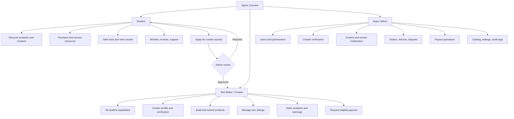

# Roles and Access Model

## Student

- Register, sign in, manage own profile and settings.
- Browse and search products and creators.
- Filter by exam, subject, topic, product type, price, rating, and difficulty.
- View product details, previews, creator credentials, reviews, and syllabus coverage.
- Purchase products and view own orders/receipts.
- Access purchased interactive tests and authorized downloads.
- Take tests, submit answers, view scores, explanations, and performance history.
- Save products to a wishlist.
- Write reviews only for eligible verified purchases.
- Apply to become a creator.
- Request support or report inaccurate/infringing content.
- Book mentorship when that feature launches.

## Test Maker / Creator

Includes all student permissions, plus:

- Apply for creator status and submit verification evidence.
- Manage own public creator profile and supported exams.
- Create, edit, preview, and submit own product drafts.
- Build MCQs with options, correct answer, explanation, topic, difficulty, and syllabus mapping.
- Upload permitted downloadable resources.
- Set product price and listing details.
- Track review status and respond to requested changes.
- Manage own published products, subject to moderation rules.
- View own product views, conversion, sales, reviews, and permitted aggregate performance insights.
- View own earnings ledger and request eligible payouts.
- Create and manage own mentorship listing when enabled.

**Creators cannot:** approve their own products, edit completed orders, alter ledger balances, approve their own payouts, or access another creator's private data.

## Super Admin

Use "Super Admin" for the **highest-trust platform role**, not a general role for every developer. Prefer granular internal permissions even if the initial UI has one admin area.

- Search users and manage account status.
- Review creator applications and verify submitted claims.
- Grant/revoke creator access.
- Review, approve, reject, suspend, or archive products.
- Moderate reviews and investigate content reports.
- Inspect orders and payment states.
- Resolve refund/dispute requests under policy.
- Review and process eligible payouts through authorized workflows.
- Manage exams, subjects, topics, categories, commission settings, and platform policies.
- View platform-wide analytics and operational health.
- Access audit logs and security controls.
- Configure support workflows and notifications.

Admin access must require strong authentication, least privilege, and auditable actions. Financial approval should be separated from creator self-service and, where feasible, require a second authorized reviewer for high-risk cases.

---

## Role and feature matrix

Legend: Full = normal capability; Own = own resources only; Request = can submit request; Moderate = authorized admin action.

| Feature | Student | Creator | Super Admin |
| --- | --- | --- | --- |
| Account/profile | Full | Full | Manage with audit |
| Browse/search catalog | Full | Full | Full |
| Purchase/take tests | Full | Full | Test access only |
| Purchased downloads | Own purchases | Own purchases | Restricted support access |
| Wishlist/reviews | Own | Own; verified purchase | Moderate |
| Creator application | Request | Already approved | Review |
| Product creation | — | Own drafts | Restricted override |
| Product publication | — | Submit for review | Approve/reject |
| Creator analytics | — | Own products | Platform-wide |
| Earnings/payout request | — | Own ledger/request | Authorized finance actions |
| User/role management | — | — | Restricted |
| Refunds/disputes | Request/support | View relevant sale status | Resolve |
| Exam taxonomy/settings | — | — | Manage |
| Audit/security logs | — | — | Restricted |

---

## Role and feature map (Mermaid)

---

## Security and authorization requirements

Use role-based permissions plus ownership checks. Example permission names:

- `product.create`
- `product.edit_own`
- `product.submit`
- `product.review`
- `order.read_own`
- `refund.resolve`
- `payout.request_own`
- `payout.approve`
- `user.role_manage`
- `audit.read`

### Rules

- Enforce access server-side and in database policies where supported.
- A creator can edit only their own drafts/listings.
- A creator cannot approve their own product or payout.
- A buyer can read only their orders, attempts, and entitlements.
- Creators should receive only the buyer information needed to fulfill a transaction.
- Admin-only endpoints require explicit authorization and audit events.
- Protect admin accounts with MFA and least privilege.
- Keep secrets out of frontend code.
- Validate uploaded files, restrict file types/sizes, and scan where possible.
- Rate-limit authentication, checkout, reviews, and report endpoints.
- Define account suspension, deletion, refunds, and content takedown behavior.
- Test cross-user access and privilege escalation before launch.

### Stack-specific enforcement

Aptivo Connect uses MongoDB Atlas with Mongoose. Enforce authorization in Next.js **server-side** route handlers, Server Actions, and service functions; scope database queries by authenticated user and resource ownership. Do not treat Mongoose schemas or UI visibility as authorization boundaries. **Never trust a client-submitted role, price, commission, or balance.**
