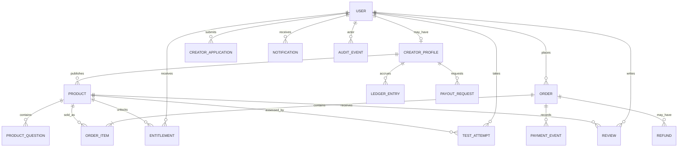

# Conceptual Data Model

## Core modules (for context)

### Shared modules
- Authentication and sessions
- Account/profile settings
- Exam, subject, topic, and syllabus catalog
- Search, filters, sorting, and recommendations
- Notifications
- Help/support and reporting
- Reviews and ratings
- Authorization and audit events

### Student modules
- Marketplace discovery
- Product detail and preview
- Checkout and order history
- Purchased library and downloads
- Test runner, attempts, results, explanations
- Wishlist
- Mentorship bookings (later)

### Creator modules
- Creator application and verification
- Creator profile
- Product/test builder
- Draft and submission workflow
- Product management
- Sales analytics
- Earnings ledger and payout requests
- Mentorship listing (later)

### Admin modules
- Admin dashboard
- User/role management
- Creator verification queue
- Product moderation queue
- Reports and review moderation
- Order/refund/dispute tools
- Payout reconciliation
- Exam taxonomy management
- Platform analytics
- Audit and security logs

---

## Entity relationship diagram

## Core entities

- `User`
- `CreatorProfile`
- `CreatorApplication`
- `Exam` / `Subject` / `Topic` / `SyllabusVersion`
- `Product`
- `ProductVersion`
- `ProductQuestion` / `AnswerOption` / `Explanation`
- `ProductFile`
- `Order` / `OrderItem`
- `PaymentAttempt` / `PaymentEvent`
- `Entitlement`
- `TestAttempt` / `AttemptAnswer` / `Result`
- `Review` / `ContentReport`
- `LedgerEntry` / `PayoutRequest` / `PayoutTransaction`
- `MentorshipListing` / `Booking` (later)
- `Notification` / `SupportTicket` / `AuditEvent`

## Important modeling decisions

- One user identity can have both student and creator capabilities.
- `CreatorProfile` is an optional profile linked to `User`.
- Use **integer minor currency units** for money (e.g. paisa), not floating-point values.
- Preserve product/question versions for attempt integrity and historical orders.
- Use a ledger with **append-only** financial entries and compensating adjustments; do not let creators directly edit balances.
- Keep payment provider references unique and idempotent.
- Store answer keys securely and reveal only according to the test policy.
- Use signed or authorized downloads; do not expose private file storage paths publicly.
- Do not collect or expose more creator identity evidence than necessary.

## Product lifecycle statuses

Suggested product statuses:
`draft`, `submitted`, `under_review`, `changes_requested`, `approved`, `published`, `rejected`, `suspended`, `archived`.

**Do not use one status field for product publication, order/payment, test attempt, and payout.** Each is a separate lifecycle — see `04_WORKFLOWS.md`.
