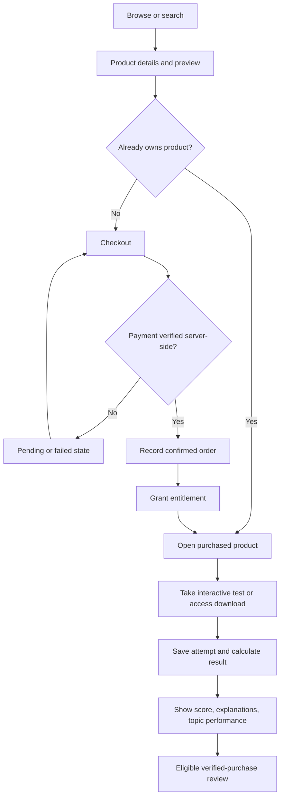
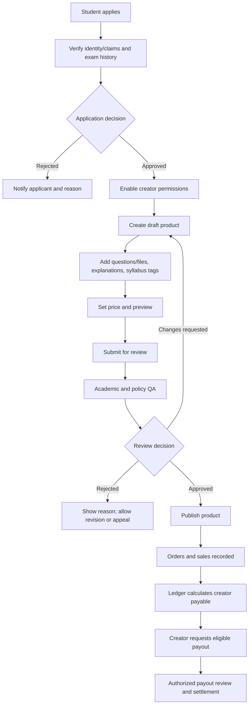

# Workflows

## 1. Student purchase-to-learning journey

### Rules
- A browser redirect is **not** proof of payment. Verify using provider-confirmed server-side status.
- Payment callbacks must be idempotent.
- Grant access only after the payment/order policy says it is safe to do so.
- Purchased access must be represented by an **entitlement**, not inferred from a client-side flag.
- Keep answer keys and explanations protected until the configured release point.
- Store test attempts against a specific product/question **version**.

---

## 2. Creator product lifecycle

---

## 3. Monetization and financial workflow

**Proposed launch hypothesis:** 80% creator / 20% platform commission. Validate the economics before locking the rate. Explicitly define whether commission is calculated before/after discounts, refunds, provider fees, and taxes.

### Workflow steps
1. Create unique order and payment attempt.
2. Verify payment server-side.
3. Record the confirmed order and payment event.
4. Grant the entitlement.
5. Create ledger entries for gross sale, commission, fees, refunds, and creator payable as applicable.
6. Make earnings eligible after the disclosed settlement/risk-review period.
7. Creator requests payout.
8. Authorized operator reviews eligibility and sends payout using a provider-supported compliant flow.
9. Reconcile provider settlement and mark payout completed/failed.
10. Notify creator and retain an audit trail.

### Payments note (Pakistan)
Potential payment methods in Pakistan must be checked with providers for marketplace eligibility, digital-product acceptance, and third-party payouts. Do not assume an ordinary merchant account supports marketplace disbursements. Confirm applicable tax, consumer-protection, privacy, and payment rules with qualified local advice.

---

## 4. Content quality and trust

### Before publishing a paid product, verify:
- Questions are original or appropriately licensed.
- Each MCQ has one defensible answer.
- Calculations and answer keys are independently checked.
- Explanations teach the solution.
- Exam, topic, syllabus, and difficulty tags are accurate.
- Mathematical notation and media render correctly.
- Preview accurately represents the product.
- Creator claims are labeled according to what was actually verified.

### After publication:
- Allow buyers to report errors and infringement.
- Track complaints by question and product.
- Suspend seriously questionable content while investigating.
- Correct content and notify affected buyers where appropriate.
- Define refund/replacement rules.
- Review syllabus changes each exam cycle.

Clearly distinguish Aptivo-owned content from third-party creator content. Do not imply official exam-body endorsement without evidence.
